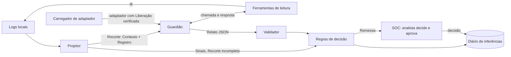

# Arquitetura do Runtime agêntico

> Rascunho de desenho, atualizado em 26/11/2026. Descreve o sistema que executa o Guardião na
> máquina monitorada. O Runtime ainda não existe: hoje ele é este documento, e vira código
> depois. Os termos seguem o [GLOSSARY.md](../../GLOSSARY.md). As decisões estão nos ADRs
> [0001](../adr/0001-guardiao-contrato-v2-sobre-recortes.md),
> [0002](../adr/0002-opensec-por-familia-e-teste-real.md),
> [0003](../adr/0003-defesa-contra-injecao-no-runtime.md),
> [0004](../adr/0004-guardiao-com-ferramentas-local.md),
> [0005](../adr/0005-rl-com-custo-multiplicativo.md),
> [0006](../adr/0006-nenhum-relato-fecha-sozinho.md),
> [0007](../adr/0007-ambiente-ait-segue-os-splits-da-v12.md),
> [0008](../adr/0008-matriz-de-custo-e-peso-de-custo.md) e
> [0009](../adr/0009-sft-com-trajetorias-derivadas.md).

## Objetivo

O Runtime agêntico roda na própria máquina monitorada, seja servidor ou endpoint. Ele transforma
os logs locais em Relatos do Guardião e envia ao SOC só a Remessa. O resultado que o estudo quer
mostrar é menos Carga no analista, com cada Relato auditável, a decisão sempre humana e os dados
mantidos na origem.

O desenho parte de cinco princípios, inspirados no Shirudo:

1. Um caminho determinístico vem antes do modelo e decide o que o modelo vê.
2. O modelo investiga só com Ferramentas de leitura e nunca age.
3. Ações saem de regras versionadas e só valem depois da aprovação humana, no SOC.
4. Todo artefato carregado é verificável, e toda inferência fica registrada e pode ser reexecutada.
5. Os dados ficam na máquina. Sai só o necessário para o analista decidir.

O Shirudo não documenta interface de IA, então nada do formato vem dele (ADR 0001).

## Fluxo

## Componentes na máquina

### Projetor

Um Projetor por Modalidade transforma o log num Recorte no mesmo formato usado no treino. Ele é
a primeira peça a construir.

- Separa o Recorte em **Contexto**, que é confiável, e **Registro**, que não é.
- Escapa no Registro os delimitadores reservados das seções e os tokens reservados de chamada e de
  resposta de ferramenta do template do Gemma 4.
- Marca **Sinais** por regras versionadas, antes do modelo: assinatura do Suricata, bloqueio do
  WAF, sinais estruturais de travessia ou SQLi, rajada de falhas de SSH.
- Declara no Contexto quando o Recorte está incompleto.
- Calcula o hash do Recorte.

O Projetor está pronto quando reproduz os Recortes aprovados da v12 a partir dos logs de origem,
com os mesmos hashes.

### Ferramentas de leitura

O catálogo tem cerca de três ferramentas tipadas por Modalidade, mais uma contagem genérica. As
chamadas usam o formato nativo do Gemma 4. Cada ferramenta corresponde a um tipo de linha de
Contexto que a curadoria já escreve.

| Modalidade | Exemplos |
| --- | --- |
| linux_auth | `falhas_de_login(usuario ou ip, janela)`, `sessoes(usuario, janela)`, `sudo(usuario, janela)` |
| sysmon | `arvore_de_processos(processo)`, `conexoes_do_processo(processo, janela)`, `eventos_do_host(event_id, janela)` |
| apache e waf | `requisicoes_do_cliente(ip, janela)`, `bloqueios_do_cliente(ip, janela)` |
| suricata | `alertas_do_ip(ip, janela)`, `fluxos_entre(ip_a, ip_b, janela)` |

Regras de todas as ferramentas:

- São somente-leitura e determinísticas.
- Têm janela máxima e limite de linhas, com marcador explícito quando a saída é cortada.
- Separam a resposta em campos calculados, que entram como Contexto, e texto copiado do log, que
  entra como Registro.
- Em produção, leem os logs locais até o momento da triagem. No treino, leem o Ambiente de
  treino, que só devolve eventos do mesmo grupo de incidente e até a Âncora.

### Carregador de adaptador

- A Liberação é uma assinatura OpenSSF Model Signing feita com chave local, sem log público. O
  manifesto traz os hashes do modelo exportado, do adaptador, da versão do dataset, da
  configuração e da revisão da base, além do Peso de custo.
- Artefato sem assinatura válida é recusado.
- A chave fica com o responsável, fora do Git e do wiki.

### Guardião e inferência local

- Em produção, o adaptador é fundido ao modelo base e exportado para GGUF de 4 bits. O modelo
  roda em CPU com llama.cpp, que já suporta o Gemma 4. Com PiSSA, a fusão parte do modelo
  residual.
- A inferência usa `enable_thinking=false` e temperatura 0.
- O Runtime passa ao Guardião o Peso de custo gravado na Liberação (ADR 0008).
- O E4B tem 4,5B de parâmetros efetivos, ou 8B com embeddings. O E2B, com 2,3B efetivos ou 5,1B
  com embeddings, é o plano B se o E4B estourar o orçamento de latência.
- O SFT e o RL do Guardião rodam no Colab L4, com TRL e vLLM. Datasets e adaptadores ficam no
  Hugging Face Hub (ADR 0005).

### Validador

Confere o Relato antes de qualquer regra:

- schema do contrato v2;
- IoCs, Evidência, CVE e componente presentes literalmente no Recorte ou nas respostas das
  ferramentas;
- CWE na lista fechada.

Um Relato inválido vai para o SOC marcado como inválido e entra no Diário com o motivo.

### Regras de decisão

As regras são versionadas e só leem campos estruturados. O rationale nunca dispara regra.

| Situação | Ação |
| --- | --- |
| Relato com Alerta | Vai ao SOC como Alerta. A Proposta de contenção por regra fica fora do estudo do artigo |
| Recorte com Sinal e Relato não-Alerta | Rebaixamento: só vale com Evidência no Contexto, incluindo campos calculados pelas ferramentas. Sem isso, o caso vai para revisão humana |
| Recorte incompleto e Relato não-Alerta | Revisão humana; nunca fecha sozinho |
| Demais Relatos não-Alerta | Fila de confirmação no SOC, confirmada em lote. Nunca fecha sozinho (ADR 0006) |

### Diário de inferências

O Diário é append-only, com uma linha por Recorte. Cada linha guarda o hash da linha anterior,
formando uma cadeia. Em intervalos fixos, o Runtime assina um checkpoint com o hash da última
linha. Uma linha alterada ou apagada quebra a cadeia a partir dela. Cada linha guarda:

- o hash do Recorte e os Sinais;
- o hash do adaptador e da Liberação, e o Peso de custo;
- as chamadas de ferramenta e o hash de cada resposta;
- o Relato e o resultado da validação;
- as regras aplicadas e suas versões;
- a build do llama.cpp e o número de threads;
- a decisão humana que volta do SOC e o horário.

O Recorte completo e as respostas brutas ficam na máquina por 30 dias, valor configurável. Esse
material permite a Reexecução: rodar de novo com a mesma build, temperatura 0 e as mesmas
threads, e conferir se o Relato se repete byte a byte.

Uma árvore de Merkle, que provaria a inclusão de uma linha sem mostrar as outras, fica como
trabalho futuro.

## O que sai da máquina

A **Remessa** é a única saída por Recorte:

- o Relato;
- as chamadas de ferramenta, com o hash de cada resposta;
- a linha do Diário;
- os hashes do Recorte e do adaptador;
- a Proposta de contenção gerada por regra, quando houver. No estudo do artigo, a Remessa sai
  sem Proposta, e o campo fica reservado.

O Recorte completo e as respostas brutas só saem quando o SOC pede, para um caso específico.
Isso aplica a minimização de dados da LGPD (art. 6º, III). Nenhum dado vai para APIs de
terceiros. A aprovação da contenção acontece no SOC. A execução da contenção fica fora do
escopo do estudo.

## Modelo de ameaça

- **O atacante controla o Registro.** Pode escrever em User-Agent, URI, linha de comando, nome de
  usuário e em várias linhas da mesma janela. Isso inclui o texto que volta das ferramentas.
- **O atacante conhece a base.** Os pesos do Gemma são públicos, então ataques de caixa-branca
  contra a base são realistas.
- **O atacante não controla** o Projetor, as ferramentas, as regras, a chave de assinatura nem
  o Contexto.
- **Objetivos do atacante:** rebaixar um Alerta (MITRE ATT&CK T1685.007), inflar Alertas para
  aumentar a Carga no analista, ou induzir chamadas de ferramenta inúteis para gastar recursos.

| Ameaça | Defesa | O que sobra |
| --- | --- | --- |
| Injeção que rebaixa um Recorte com Sinal | Rebaixamento exige Evidência do Contexto | Nada, se as regras de Sinal acertarem |
| Injeção que rebaixa um Recorte sem Sinal | Só o treino | Medido pela Suíte adversarial |
| Injeção que infla Alertas | Aprovação humana no SOC | Carga no analista, medida pela Suíte |
| Injeção via texto devolvido pelas ferramentas | Texto copiado do log é Registro | Medido pela Suíte |
| Tokens de ferramenta forjados no log | Escape no Projetor e nas ferramentas | Medido pela Suíte |
| Adaptador trocado ou trojanizado | Assinatura verificada na carga | Dados envenenados antes da Liberação (ADR 0002) |
| Saída malformada | Validador | Nenhum efeito automático |

As mitigações M1047 (auditar a análise) e M1038 (o conteúdo analisado não controla o fluxo) da
técnica T1685.007 correspondem ao Diário e às regras de decisão.

## Métricas

Os malicious perdidos são uma restrição em todas as medidas.

| Eixo | Métrica |
| --- | --- |
| Carga no analista | Relatos que exigem humano a cada 1.000 Recortes; tamanho e tempo de confirmação da Fila de confirmação; falsos positivos que chegam ao SOC por dia numa prevalência declarada; tamanho do Relato com Evidência comparado com o Recorte bruto. Com aprovação do CEP, também NASA-TLX ou RTLX, tempo por Recorte e Erros plantados aceitos no Estudo com analistas |
| Auditabilidade e supervisão | TARr@N e TARa@N na Reexecução, variando threads, build e CPU; taxa de detecção de adulterações injetadas no Diário, com meta de 100%; custo por linha do Diário; % de Evidência verificável literalmente; aprovação humana registrada em toda contenção |
| Governança local | Bytes e campos pessoais que saem da máquina por Relato, comparados com o envio de logs brutos ao SIEM; zero envios a terceiros |
| Custo local | Tokens gerados e lidos, chamadas de ferramenta, latência p50 e p95 e pico de memória na máquina de referência x86 sem GPU e no Mac |

## Ordem de construção

1. Projetor por Modalidade, reproduzindo os hashes da v12.
2. Ambiente de treino e catálogo de Ferramentas de leitura.
3. Validador, Diário de inferências e Reexecução.
4. Regras de decisão e montagem da Remessa.
5. Exportação para GGUF, assinatura e verificação da Liberação, junto com o primeiro adaptador
   com ferramentas.

## Pontos em aberto

- **Catálogo final de Sinais por Modalidade.** As regras precisam de aprovação do responsável,
  com versão e testes. O catálogo de ferramentas segue a regra do ADR 0009.
- **Formato do lote da Fila de confirmação.** O Runtime e o Estudo com analistas precisam usar o
  mesmo.

## Trabalho futuro

- **Catálogo de Propostas de contenção.** Tipos de ação e mapeamento a partir do Veredito, da
  Severidade e da Hipótese de vulnerabilidade. Fica fora do artigo, porque avaliar o efeito das
  ações exige dados que o estudo não tem.
