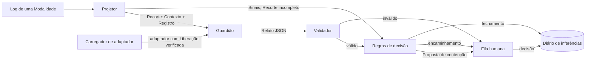

# Arquitetura do Runtime agêntico

> Rascunho de desenho, 25/11/2026. Descreve o sistema que executa o Guardião fora do
> laboratório. O Runtime ainda não existe: hoje ele é este documento, e vira projeto próprio
> depois. Os termos seguem o [GLOSSARY.md](../../GLOSSARY.md). As decisões estão nos ADRs
> [0001](../adr/0001-guardiao-contrato-v2-sobre-recortes.md),
> [0002](../adr/0002-opensec-por-familia-e-teste-real.md) e
> [0003](../adr/0003-defesa-contra-injecao-no-runtime.md).

## Objetivo

O Runtime agêntico transforma logs de SOC em Relatos do Guardião e transforma Relatos em
Propostas de contenção para aprovação humana. O desenho parte de quatro princípios, inspirados
no Shirudo:

1. Um caminho determinístico vem antes do modelo e decide o que o modelo vê.
2. O modelo relata e nunca age: não chama ferramentas, não pede contexto e não propõe contenção.
3. Ações saem de regras versionadas e só valem depois da aprovação humana.
4. Todo artefato que o Runtime carrega é verificável, e toda inferência fica registrada.

O Shirudo não documenta interface de IA, então nada do formato vem dele (ADR 0001).

## Fluxo

## Componentes

### Projetor

Um Projetor por Modalidade transforma o log num Recorte no mesmo formato usado no treino. Ele é
a primeira peça a construir.

- Separa o Recorte em **Contexto**, que é confiável, e **Registro**, que não é.
- Escapa no Registro os delimitadores reservados das duas partes, para que o log não consiga
  abrir ou fechar uma seção.
- Marca **Sinais** por regras versionadas, antes do modelo: assinatura do Suricata, bloqueio do
  WAF, sinais estruturais de travessia ou SQLi, rajada de falhas de SSH.
- Declara no Contexto quando o Recorte está incompleto.
- Calcula o hash do Recorte.

Hoje as projeções saem de scripts diferentes em cada lote de curadoria. O critério de pronto do
Projetor é reproduzir os Recortes aprovados da v12 a partir dos logs de origem, com os mesmos
hashes.

### Carregador de adaptador

Carrega a base e o adaptador e verifica a Liberação antes de qualquer inferência.

- A Liberação é uma assinatura OpenSSF Model Signing feita com uma chave local, sem log público.
  O manifesto traz os hashes do adaptador, da versão do dataset, da configuração e da revisão da
  base.
- Adaptador sem assinatura válida é recusado. Isso cobre a troca de arquivo e o adaptador
  trojanizado vindo de fora.
- A chave fica com o responsável, fora do Git e do wiki.

### Guardião

O modelo recebe um Recorte e devolve um único Relato em JSON puro, com `enable_thinking=false` e
temperatura 0. Ele não chama ferramentas e não vê nada além do Recorte.

### Validador

Confere o Relato antes de qualquer regra:

- schema do contrato v2;
- IoCs, Evidência, CVE e componente presentes literalmente no Recorte;
- CWE na lista fechada.

Um Relato inválido vai para a fila humana e entra no Diário com o motivo.

### Regras de decisão

As regras são versionadas e só leem campos estruturados. O rationale nunca dispara regra.

| Situação | Ação |
| --- | --- |
| Relato com Alerta | Gera uma Proposta de contenção e envia para aprovação humana |
| Recorte com Sinal e Relato não-Alerta | Rebaixamento: só vale se alguma Evidência estiver literalmente no Contexto. Sem isso, o caso vai para revisão humana |
| Recorte incompleto e Relato não-Alerta | Revisão humana; nunca fecha sozinho |
| Demais Relatos não-Alerta | Ver "Pontos em aberto" |

### Fila humana

O analista aprova ou recusa Propostas de contenção e revisa os casos encaminhados. O Relato
mostra a Evidência e o Risco de falso positivo para reduzir o viés de automação. A decisão volta
para o Diário.

### Diário de inferências

O Diário é um histórico append-only com uma linha por Recorte. Cada linha guarda:

- o hash do Recorte e os Sinais;
- o hash do adaptador e da Liberação;
- o Relato e o resultado da validação;
- as regras aplicadas e suas versões;
- o encaminhamento, a decisão humana e o horário.

A retenção de referência é de seis meses, seguindo o art. 19 do AI Act como boa prática e não
como obrigação demonstrada.

## Modelo de ameaça

- **O atacante controla o Registro.** Pode escrever em User-Agent, URI, linha de comando, nome de
  usuário e em várias linhas da mesma janela.
- **O atacante conhece a base.** Os pesos do Gemma são públicos, então ataques de caixa-branca
  contra a base são realistas.
- **O atacante não controla** o Projetor, as regras, a chave de assinatura nem o Contexto.
- **Objetivos do atacante:** rebaixar um Alerta (MITRE ATT&CK T1685.007) ou inflar Alertas para
  causar fadiga.

| Ameaça | Defesa no Runtime | O que sobra |
| --- | --- | --- |
| Injeção que rebaixa um Recorte com Sinal | Rebaixamento exige Evidência do Contexto | Nada, se as regras de Sinal acertarem |
| Injeção que rebaixa um Recorte sem Sinal | Nenhuma regra; só o treino | Medido pela Suíte adversarial |
| Injeção que infla Alertas | Aprovação humana da contenção | Fadiga do analista, medida pela Suíte |
| Delimitadores forjados ou Context Stitching | Escape no Projetor | Medido pela Suíte |
| Adaptador trocado ou trojanizado | Assinatura verificada na carga | Dados envenenados antes da Liberação (ADR 0002) |
| Saída malformada | Validador e fila humana | Nenhum efeito automático |

As mitigações M1047 (auditar a análise) e M1038 (o conteúdo analisado não controla o fluxo) da
técnica T1685.007 correspondem ao Diário e às regras de decisão.

## Métricas de operação

- Taxa de encaminhamento para humanos, por motivo.
- Falsos positivos observados nas decisões humanas, por Modalidade.
- Latência p50 e p95 por Recorte, tokens por segundo e pico de memória.
- Rebaixamentos aceitos e recusados.

## Ordem de construção

1. Projetor por Modalidade, reproduzindo os hashes da v12.
2. Validador e Diário de inferências.
3. Regras de decisão e fila humana.
4. Assinatura e verificação da Liberação, junto com o primeiro adaptador v2.

## Pontos em aberto

- **Fechamento automático dos demais Relatos não-Alerta.** As regras aceitas só proíbem fechar
  sozinho os casos com Sinal sem Contexto e os Recortes incompletos. Ligar ou não o fechamento
  automático dos outros casos é decisão de implantação.
- **Catálogo de Sinais por Modalidade.** As regras precisam de aprovação do responsável, com
  versão e testes.
- **Catálogo de Propostas de contenção.** Falta definir os tipos de ação e o mapeamento a partir
  do Veredito, da Severidade e da Hipótese de vulnerabilidade.
